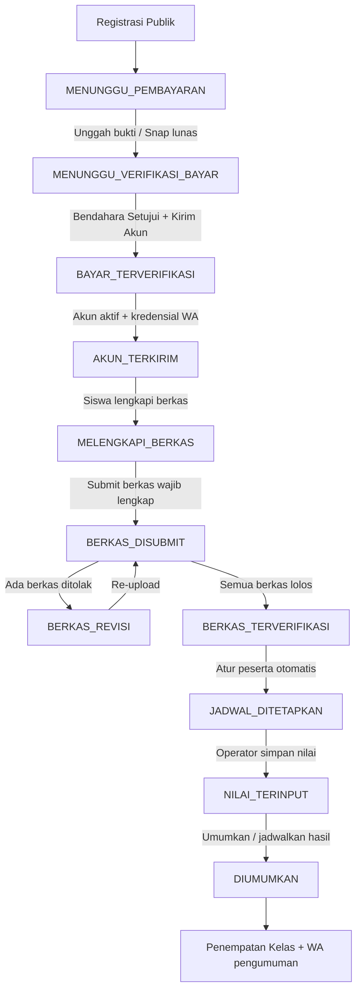

# Alur Pendaftaran SPMB — SMP Muhammadiyah 5 Kota Tangerang

Dokumen ini merangkum alur end-to-end SPMB (Fase 0–11), model status `pendaftar.tahap`, tabel/kolom yang ditambahkan per fase, dan titik integrasi eksternal.

## Alur Utama (Mermaid)

## Model Status `pendaftar.tahap`

| # | Nilai | Arti | Pemicu perubahan |
|---|-------|------|------------------|
| 1 | `MENUNGGU_PEMBAYARAN` | Menunggu unggah bukti / bayar gateway | Registrasi selesai |
| 2 | `MENUNGGU_VERIFIKASI_BAYAR` | Bukti masuk, menunggu bendahara | Unggah bukti / callback gateway |
| 3 | `BAYAR_TERVERIFIKASI` | Pembayaran disetujui | Verifikasi bendahara (F4) |
| 4 | `AKUN_TERKIRIM` | Akun siswa aktif, kredensial terkirim | Verifikasi & kirim akun 1-klik (F4) |
| 5 | `MELENGKAPI_BERKAS` | Siswa mengunggah berkas persyaratan | Login portal siswa |
| 6 | `BERKAS_DISUBMIT` | Berkas disubmit, menunggu panitia | Submit berkas wajib lengkap (F5) |
| 7 | `BERKAS_REVISI` | Ada berkas ditolak, hanya berkas itu dibuka | Keputusan tolak panitia (F5) |
| 8 | `BERKAS_TERVERIFIKASI` | Semua berkas lolos | Setujui semua berkas (F5) |
| 9 | `JADWAL_DITETAPKAN` | Masuk peserta ujian + nomor peserta | Atur peserta otomatis/manual (F6) |
| 10 | `NILAI_TERINPUT` | Nilai CBT/BTQ/Wawancara tersimpan | Simpan tabel / impor CSV (F7) |
| 11 | `DIUMUMKAN` | Hasil resmi diumumkan | Umumkan sekarang / jadwal lewat (F8) |

## Tabel & Kolom Baru per Fase

### Fase 0 — Prasyarat
- `pendaftar.tahap` ENUM (11 nilai, lihat tabel di atas), `pendaftar.pay_token`
- `login_attempts` (rate-limit login 5 gagal / 15 menit / IP)

### Fase 1 — S&K & Registrasi
- `pengaturan_sekolah.syarat_ketentuan` LONGTEXT, `syarat_versi` INT
- `pendaftar.syarat_versi`, `pendaftar.sak_diterima_pada`

### Fase 2 — Pembayaran
- `pengaturan_sekolah.bayar_gateway_aktif`, `bayar_transfer_aktif`, `bayar_qris_aktif`, `qris_image_url`, `qris_merchant`, `kirim_akun_otomatis`
- `pembayaran` (jenis, nominal, status, bukti, pay_token)

### Fase 3 — Notifikasi Operator
- `notifikasi` (tipe, pendaftar_id, pesan, is_read)
- `wa_log` (tujuan, tipe, status, respons)
- `pengaturan_sekolah.notif_wa_operator`, `notif_wa_aktif`, `notif_email` (titik sambungan)
- `app/api/notif-count.php` (polling sidebar 60 dtk)

### Fase 4 — Verifikasi Bayar + Kirim Akun
- `pendaftar.tahap` nilai `BAYAR_TERVERIFIKASI` & `AKUN_TERKIRIM`
- Idempoten: `verifikasi_kirim_akun()` — klik ulang tidak dobel
- Pemicu: `BUKTI_BAYAR_MASUK`, `PEMBAYARAN_GATEWAY_LUNAS`

### Fase 5 — Berkas Dinamis
- `jenis_dokumen` (nama, kode, wajib, format, maks_kb, is_aktif; seed 6 jenis)
- `dokumen` kolom: `catatan_verifikasi`, `verified_by`, `verified_at`; `jenis` VARCHAR(30)
- `dokumen_siswa()`, `dokumen_upload()`, `dokumen_submit()`, `berkas_keputusan()`, `berkas_evaluasi_tahap()`
- Halaman: `app/operator/berkas.php`, `app/operator/jenis-dokumen.php`

### Fase 6 — Jadwal Ujian & Peserta
- `jadwal_tes.ruangan` VARCHAR(100), `kapasitas` INT (0 = tanpa batas)
- `peserta_ujian` (pendaftar_id UNIQUE, jadwal_id, nomor_peserta UNIQUE, ruangan)
- `peserta_atur_otomatis()` (transaksi DB, urut no_pendaftaran, penuhi kapasitas)
- `peserta_kartu_siswa()` — Kartu Peserta + CSS print di portal siswa
- Halaman: `app/operator/peserta-ujian.php`

### Fase 7 — Seleksi
- `pendaftar_untuk_nilai()` difilter `tahap IN (JADWAL_DITETAPKAN, NILAI_TERINPUT)`
- `seleksi_simpan()` → set `tahap=NILAI_TERINPUT` (struktur nilai TIDAK berubah)
- `seleksi_impor_nilai()` — CSV upsert, pertahankan hasil LULUS/TIDAK_LULUS lama
- `lulus_belum_ditempatkan_jumlah()` — peringatan sebelum pengumuman

### Fase 8 — Pengumuman
- `pengaturan_sekolah.hasil_diumumkan_pada` DATETIME NULL
- `pengumuman_status()`, `pengumuman_umumkan_sekarang()`, `pengumuman_jadwalkan()`, `pengumuman_batalkan_jadwal()`
- `pengumuman_wa_batch()` — 10 nomor per request (AJAX), `wa_log` tipe `PENGUMUMAN`
- Peringatan: LULUS tanpa kelas → wajib konfirmasi eksplisit
- Cek-status publik: **wajib no_pendaftaran + 4 digit WA** (pencarian nama dihapus)
- Hasil seleksi & penempatan disembunyikan publik/portal sampai diumumkan
- Halaman: `app/operator/pengumuman.php`, API `app/api/pengumuman-wa.php`

### Fase 9 — Panduan & Dokumentasi
- `app/operator/panduan.php` — SOP per peran (operator, bendahara, kepsek)
- `.env.example` — template kredensial (DB, Fonnte, Midtrans)
- `docs/ALUR-PENDAFTARAN.md` — dokumen ini

### Fase 10 — Gateway Opsional + Hardening
- **Bagian A (opsional)**: Midtrans `DEFAULT 0` + toggle `bayar_gateway_aktif` di Pengaturan
  (paksa-0 server-side saat key belum diatur). Tautan/gateway memakai `gateway_tersedia()`.
- **Bagian B (akun)**: `tools/set-password.php` (CLI-only) menggantikan `hak akses.txt`
  yang **dihapus dari repository**; kolom `users.wajib_ganti_password` + gate
  `require_role()` (staf dipaksa ke Ganti Password). Upload bukti bayar: wajib CSRF +
  `pay_token` 64-hex + cek metode/tahap + hapus bukti lama + rate tiap percobaan.
- **Bagian C**: `rate_limit_cek/catat(..., $kunci)` — rate lintas IP per no_pendaftaran
  (cek-status & pemulihan tautan); pesan "tidak ditemukan" & "4 digit salah" **seragam**
  (anti-enumerasi); `pengumuman_status()` **read-only** (finalisasi tahap di jalur operator).
- **Bagian D**: `url_abs()` + env `APP_URL` untuk tautan WhatsApp; **kepsek tidak lagi**
  boleh mengunduh berkas pribadi di `app/api/dokumen.php`.

### Fase 11 — Tutup Sisa Fase 10 + Kesiapan Produksi

- **Bagian A (WA, akun, token)**:
  - `pendaftar.pay_token_hash CHAR(64) UNIQUE` — kolom `pay_token` polos tidak lagi
    disimpan/disimpan ulang di DB (hanya SHA-256); registrasi idempoten **merotasi**
    pay_token sehingga tautan bayar lama mati. Helper tahap:
    `tahap_urutan()/tahap_index()/tahap_minimal()` (`includes/functions.php`).
  - `app/api/snap-token.php`: publik hanya produk **FORMULIR**; uang masuk hanya
    dari portal siswa dengan tahap ≥ `BERKAS_TERVERIFIKASI` (dan belum VERIFIED/LUNAS).
  - `app/staf/ganti-password.php`: min 10 karakter, tolak = username / = lama,
    rate 5 percobaan / 15 menit (per IP + per user), `session_regenerate_id(true)` sukses.
  - `wa_pesan_instruksi()` (`includes/fonnte.php`): instruksi WA hanya memuat metode
    yang **aktif** di pengaturan, langkah akhir diseragamkan ("Setelah pembayaran
    terverifikasi, akun dan password dikirim lewat WhatsApp.") — kartu sukses registrasi
    memakai sumber yang sama.
  - Rate registrasi WA `registrasi_wa` 3 kali / nomor / 24 jam.
  - Cek-status: kunci rate per-nomor hanya untuk format `REG-YYYY-NNNN` valid,
    hanya dicatat saat **gagal**; pembersih `rate_limit_bersihkan()` (baris >2 hari,
    ±1% request acak, LIMIT 1000) dipanggil dari `includes/config.php`.
  - WA penolakan verifikasi dokumen menautkan ke cek-status (bukan halaman bayar).
  - Seed utama: akun staf `'!LOCKED'` (reset via CLI).
- **Bagian B (instrumen rilis)**:
  - `tools/buat-paket.php` — zip rilis CLI-only, mengecualikan `.env`, `.git`, `dist`,
    isi `storage/dokumen` (non-demo), `storage/backup`, dan file rahasia; verifikasi
    pasca-build otomatis.
  - `tools/cek-proyek.php` — 8 pemeriksaan (versi PHP, ekstensi, `.env`, koneksi+skema,
    izin storage, php.ini, akun `!LOCKED`/hash lemah); exit 1 bila GAGAL.
  - `tools/backup-db.php` (mysqldump + gzip, password lewat env `MYSQL_PWD`,
    rotasi 14 hari) & `tools/backup-berkas.php` (zip `storage/dokumen`, rotasi 14 hari).
  - `docs/DEPLOY.md`: cadangan terjadwal, rilis/pembaruan, pemulihan bencana.
  - `.gitattributes` (LF) + `.editorconfig` (UTF-8 tanpa BOM, indent 4).
  - `database/seed_demo.sql` — 9 pendaftar demo (11/11 tahap tercakup), users siswa
    demo `'!LOCKED'`, orang tua, pembayaran, 26 dokumen, 3 peserta ujian, 2 seleksi;
    idempoten; pasangan `seed_demo_hapus.sql`.
- **Bagian C (kesiapan)**: `app/operator/kesiapan.php` — checklist kesiapan 13 item
  (read-only): APP_URL, placeholder rekening/WA panitia, jadwal+S&K, akun `!LOCKED`,
  hash lemah, skema `pay_token_hash`, metode bayar, kunci Midtrans, token Fonnte,
  izin storage, umur cadangan DB, notif WA operator; skor % + kartu antrean operasional
  per tahap; menu sidebar **Kesiapan Rilis** (operator/admin).

## Alur Lengkap (Fase per Fase)

### Fase 0 — Prasyarat
Kolom `tahap`, `pay_token`, tabel `login_attempts`. Rate-limit login.

### Fase 1 — S&K & Registrasi
Registrasi publik → setujui S&K (versi tercatat) → bayar formulir → `MENUNGGU_PEMBAYARAN`.

### Fase 2 — Pembayaran
Gateway Midtrans Snap (aktif default) / transfer bank manual / QRIS manual. Callback → `MENUNGGU_VERIFIKASI_BAYAR`.

### Fase 3 — Notifikasi Operator
`notif_operator()` → `notifikasi` + `wa_log`. Sidebar badge + polling 60 dtk. Halaman Notifikasi.

### Fase 4 — Verifikasi Bayar + Kirim Akun
Bendahara: Setujui (`VERIFIED+BAYAR_TERVERIFIKASI`), Tolak (wajib alasan, kembali MENUNGGU_PEMBAYARAN, WA alasan). Tombol "Verifikasi & Kirim Akun" 1 klik idempoten. Gateway auto-kirim (default nonaktif).

### Fase 5 — Berkas Dinamis
`jenis_dokumen` CRUD. Siswa unggah → validasi format/size/MIME. Submit hanya bila wajib lengkap → `BERKAS_DISUBMIT` + kunci + notif. Verifikasi per berkas → semua lolos `BERKAS_TERVERIFIKASI`, ada ditolak `BERKAS_REVISI` + WA + hanya berkas ditolak dibuka.

### Fase 6 — Jadwal Ujian OFFLINE
`jadwal_tes` + ruangan/kapasitas/jam. `peserta_ujian` (nomor_peserta unik). "Atur Peserta Otomatis" urut no_pendaftaran penuhi kapasitas (transaksi DB). `tahap=JADWAL_DITETAPKAN` + WA. Kartu Peserta (CSS print).

### Fase 7 — Seleksi
Hanya tampilkan `JADWAL_DITETAPKAN`/`NILAI_TERINPUT`. Struktur nilai TIDAK berubah. Setelah nilai → `NILAI_TERINPUT`. Impor CSV opsional + pratinjau. Hasil LULUS/TIDAK_LULUS tetap operator. Peringatan lulus tanpa kelas.

### Fase 8 — Pengumuman
`hasil_diumumkan_pada` (DATETIME NULL). Sembunyikan hasil sampai waktu. Halaman Pengumuman + "Umumkan Sekarang"/"Jadwalkan" (aktif bila tak ada lulus tanpa kelas / konfirmasi eksplisit). `tahap=DIUMUMKAN` + WA bertahap 10/request (AJAX progres) + `wa_log` + "Kirim ulang yang gagal". Cek-status publik: wajib no_pendaftaran + 4 digit WA.

### Fase 9 — Panduan & Dokumentasi
SOP per peran. `.env.example`. Dokumen ini. Uji e2e manual lengkap.

### Fase 10 — Gateway Opsional + Hardening
Pembayaran online bersifat **opsional** (toggle + paksa-0 server-side). Reset password
via `php tools/set-password.php <username>` (CLI) → paksa ganti password. Unggah bukti
bayar publik: CSRF + `pay_token` + metode/tahap aktif. Cek-status: pesan seragam +
rate per no_pendaftaran. Tautan WA absolut (`url_abs`/`APP_URL`). Kepsek keluar dari
gate unduh berkas pribadi.

### Fase 11 — Tutup Sisa Fase 10 + Kesiapan Produksi
Token bayar disimpan sebagai **hash UNIQUE** (`pay_token_hash`) — registrasi idempoten
merotasi token sehingga tautan lama mati; token polos hanya tampil di 3 titik terbatas
(sukses registrasi, pesan WA, hasil pemulihan cek-status). Snap-token uang masuk hanya
lewat portal siswa ≥ BERKAS_TERVERIFIKASI (publik hanya FORMULIR). Ganti password
diperketat (min 10, tolak=username/lama, rate 5/15 menit IP+user, regenerasi sesi).
Instruksi WA hanya memuat metode aktif + kalimat penutup seragam; registrasi WA
dibatasi 3/nomor/24 jam. Cek-status: kunci per-nomor hanya utk format valid & hanya
saat gagal + pembersih rate_limit otomatis. Tools rilis CLI-only: `buat-paket`,
`cek-proyek` (8 pemeriksaan), `backup-db`, `backup-berkas` (rotasi 14 hari);
paket rilis bebas `.env`/rahasia. Seed demo lengkap 11/11 tahap + `seed_demo_hapus.sql`.
Halaman **Kesiapan Rilis** (`app/operator/kesiapan.php`): checklist kesiapan, skor %,
kartu antrean operasional — read-only.

## Integritas & Keamanan

- **CSRF**: semua form POST dilindungi `csrf_cek()` / `csrf_field()`.
- **Prepared statement**: semua query via PDO prepared statement.
- **Escape output**: semua output via `e()`.
- **Rate limit**: login (5/15mnt/IP), cek-status (10/15mnt/IP **+** 5/15mnt/no_pendaftaran),
  pulihkan-bayar (3/jam/IP **+** 3/jam/no_pendaftaran), unggah bukti (10/menit/IP, tiap percobaan dicatat).
- **Gate dokumen**: akses file berkas via `app/api/dokumen.php` — login + kepemilikan;
  **hanya operator/admin/bendahara** (kepsek tidak lagi ikut, Fase 10).
- **Akun**: `hak akses.txt` dihapus dari disk; reset password via CLI `tools/set-password.php`
  (min 10 karakter, set `wajib_ganti_password=1`); staf wajib ganti password sebelum halaman lain.
- **Unggah bukti bayar**: CSRF wajib, `pay_token` regex `^[a-f0-9]{64}$`, metode/tahap dicek server-side,
  file lama dihapus hanya bila path di `storage/dokumen/` & nama sesuai pola.
- **Pengumuman**: `pengumuman_status()` hanya membaca (finalisasi tahap dijalankan eksplisit oleh operator).
- **Pesan anti-enumerasi**: cek-status memakai satu pesan sama untuk "tidak ditemukan" & "4 digit salah";
  kunci rate per-nomor hanya dicatat untuk format `REG-YYYY-NNNN` valid dan hanya saat percobaan **gagal**
  (pencarian sukses tidak menambah hitungan).
- **Idempotensi**: kirim akun (klik ulang tidak dobel), pengumuman (finalisasi tahap idempoten),
  registrasi ulang (reuse reg_token **+ rotasi pay_token** — tautan bayar lama mati).
- **Transaksi DB**: penempatan otomatis, atur peserta otomatis, impor CSV, unggah bukti bayar (gagal → tanpa perubahan).
- **Token bayar**: hanya `pay_token_hash` (SHA-256, UNIQUE) tersimpan di DB; `pay_token` polos selalu NULL.
  Titik tampil token polos dibatasi 3: halaman sukses registrasi, pesan WA registrasi, hasil pemulihan cek-status.
- **Rate limit Fase 11**: ganti-password 5/15 menit (per IP + per user), registrasi-WA 3/nomor/24 jam;
  `rate_limit_bersihkan()` menghapus baris >2 hari (±1% request acak, maks 1000 baris).
- **Gate API**: `app/api/snap-token.php` — publik hanya produk FORMULIR; uang masuk hanya dari portal
  siswa tahap ≥ BERKAS_TERVERIFIKASI dan pembayaran belum VERIFIED/LUNAS.
- **Alat rilis**: `tools/buat-paket.php`, `tools/cek-proyek.php`, `tools/backup-db.php`,
  `tools/backup-berkas.php` — semuanya **CLI-only** (akses web 404); zip rilis diverifikasi bebas
  `.env`/rahasia; cadangan DB & berkas otomatis rotasi 14 hari.
- **Kesiapan produksi**: `app/operator/kesiapan.php` (operator/admin) — checklist read-only 13 item
  + skor + antrean operasional; pemeriksaan teknis lanjutan via `php tools/cek-proyek.php`.
- **Arsip pendaftaran (soft archive)**: operator/admin menandai pendaftar selesai/batal lewat
  `pendaftar_arsip()` (`arsip_at`/`arsip_alasan`/`arsip_oleh`) — **tidak ada hapus permanen** karena
  7 FK cascade ke pembayaran, dokumen, koreksi, peserta ujian, seleksi & penempatan kelas.
  Akun siswa ikut `is_active=0` sementara dan dipulihkan oleh `pendaftar_pulih()`. Semua antrean kerja,
  statistik, export CSV, counter publik, cek-status, dan tautan bayar menyaring `arsip_at IS NULL`;
  data lama tetap terbaca lewat filter **Tampilkan = Terarsip**. Rate limit 10/jam per operator.

## Kredensial Default (GANTI SEBELUM GO-LIVE!)

Seed SQL utama (Fase 11): akun **staf terkunci** (`'!LOCKED'`) — tidak bisa
login sampai diatur via CLI. Akun siswa demo hanya di `database/seed_demo.sql`
(UAT/opsional, juga terkunci).

| Role | Username | Password seed | Set password via |
|------|----------|---------------|------------------|
| Operator | `operator` | `!LOCKED` (tidak bisa login) | `php tools/set-password.php operator` |
| Bendahara | `bendahara` | `!LOCKED` (tidak bisa login) | `php tools/set-password.php bendahara` |
| Kepsek | `kepsek` | `!LOCKED` (tidak bisa login) | `php tools/set-password.php kepsek` |
| Siswa (demo, seed_demo.sql) | `siswa` | `!LOCKED` (tidak bisa login) | `php tools/set-password.php siswa` |

Setelah reset, akun staf akan **dipaksa Ganti Password** pada login berikutnya.
Detail deploy: `docs/DEPLOY.md`.

## Environment Variables

Lihat `.env.example`. Variabel: `DB_*`, `FONNTE_TOKEN`, `MIDTRANS_SERVER_KEY`, `MIDTRANS_CLIENT_KEY`,
`MIDTRANS_SANDBOX`, `APP_URL` (URL publik untuk tautan WhatsApp; kosongkan di localhost).

## Migration Files

| Fase | File |
|------|------|
| 0 | `database/migrations/20261012_fase0_prasyarat.sql` |
| 1 | `database/migrations/20261012_fase1_sak_registrasi.sql` |
| 2 | `database/migrations/20261012_fase2_pembayaran.sql` |
| 3 | `database/migrations/20261012_fase3_notifikasi.sql` |
| 4 | `database/migrations/20261012_fase4_verifikasi_akun.sql` |
| 5 | `database/migrations/20261012_fase5_berkas_dinamis.sql` |
| 6 | `database/migrations/20261013_fase6_peserta_ujian.sql` |
| 8 | `database/migrations/20261013_fase8_pengumuman.sql` |
| 10 | `database/migrations/20261015_fase10_gateway_opsional.sql` |
| 10 | `database/migrations/20261015_fase10_keamanan.sql` |
| 11 | `database/migrations/20261016_fase11_pay_token_hash.sql` |
| 12 | `database/migrations/20261017_fase12_retensi.sql` |
| 13 | `database/migrations/20261026_fase13_koreksi_data.sql` |
| — | `database/migrations/20261028_arsip_pendaftar.sql` (kolom `arsip_at`/`arsip_alasan`/`arsip_oleh` — pengarsipan soft-delete pendaftar) |

Seed lengkap: `database/db_spmb_mualimku.sql` (gabungan semua fase).
Dokumentasi uji: `docs/UJI-MANUAL.md`.

---

*Dokumen ini diperbarui saat setiap fase diselesaikan (terakhir: Fase 11 — Tutup Sisa Fase 10 + Kesiapan Produksi).*
